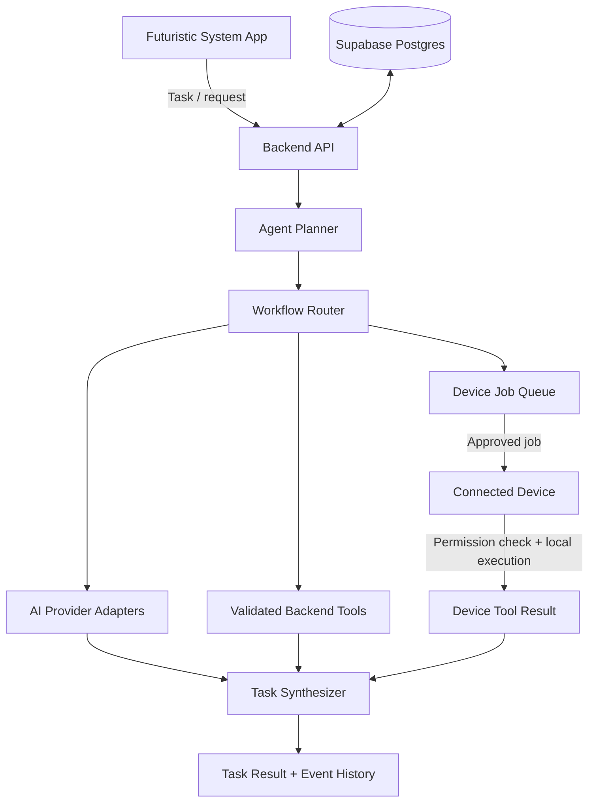

<div align="center">

# Futuristic System
### AI Orchestration Backend · MCP Server · Device Bridge

**The coordination layer behind a personal AI system.**

Connect AI providers, tools, memory, and trusted devices through one modular backend — while keeping device permissions and sensitive local actions under the user's control.

<br/>

[](https://nextjs.org/)
[](https://www.typescriptlang.org/)
[](https://modelcontextprotocol.io/)
[](https://supabase.com/)
[](https://render.com/)

<br/>

**Project status:** Backend foundation in active development · Android runtime integration pending

</div>

---

## What is Futuristic System?

Futuristic System is being built as a personal AI platform: one system that can understand a task, choose the right AI model, use approved tools, remember useful context, and coordinate work across connected devices.

This repository contains its **backend foundation** — not the Android application itself.

The backend acts as the system's orchestration and integration layer. It provides a common place to manage AI providers, route work by workflow, expose capabilities through the Model Context Protocol (MCP), persist owner memory, and coordinate device-side jobs.

### The problem it solves

AI capabilities are often fragmented:
- Different tasks need different models and providers.
- Tools and device capabilities are exposed through different interfaces.
- Context and task history are difficult to keep consistent.
- Cloud services should not silently gain access to private device data or permissions.

Futuristic System brings these concerns behind one modular backend, with an explicit boundary between **cloud coordination** and **local device execution**.

## Core design

> **One AI system. Multiple providers. Validated tools. Persistent context. User-controlled devices.**

| Layer | Responsibility |
| --- | --- |
| AI orchestration | Plan tasks and coordinate multi-step execution |
| Provider routing | Select a provider/model for each workflow, with fallback |
| MCP interface | Expose tools, resources, and prompts through a standard protocol |
| Tool layer | Validate arguments and execute allow-listed backend capabilities |
| Memory | Store and retrieve persistent owner context |
| Device bridge | Register devices, discover capabilities, queue jobs, and receive results |
| Command Centre | Configure providers, workflow policies, tools, memory, and devices |

## Architecture

The backend is designed to coordinate work without taking over the device.



### Typical task lifecycle

1. **Receive** — accept a task through the backend API or MCP.
2. **Plan** — break the request into structured steps.
3. **Route** — select a workflow-specific provider/model or an approved tool.
4. **Validate** — check tool names and arguments against known schemas.
5. **Execute** — run backend tools on the server, or queue device work for a connected device.
6. **Verify and synthesize** — combine returned evidence and execution results.
7. **Persist** — retain task events and permitted memory for continuity.

The device bridge is a coordination contract: the backend does not directly access a phone's files, camera, sensors, installed apps, or Android permissions.

## Capabilities

### AI provider and model routing
- Provider adapters for OpenAI-compatible APIs, OpenRouter, and a deterministic mock provider.
- Workflow-specific provider/model policies.
- Retryable fallback routing.
- Encrypted provider credential storage using AES-256-GCM.
- Usage limits and provider health/observability.

### Agent execution and Agent Manager
- Structured task planning with strict validation of plans and tool arguments.
- Persistent, owner-managed specialist Agent definitions with role and instruction guidance.
- Per-Agent provider/model preferences, registered-tool allowlists, and bounded step/tool-call limits.
- Agent configuration snapshots retained with task history, even if a definition is later edited or deleted.
- Owner-authenticated Agent Manager CRUD APIs and dashboard at `/dashboard/agents`.
- Allow-listed backend tools, task status, event history, and result synthesis.

### Model Context Protocol
- Streamable HTTP JSON-RPC endpoint at `/api/mcp`.
- Tools, resources, and prompts discovery and invocation.
- Stateless MCP transport.

### Persistent memory
- Owner-scoped memory storage and search.
- Supabase Postgres persistence.
- Memory management endpoints.

### Device coordination
- Device registration and capability discovery.
- Queued device-tool jobs.
- Job claiming and result callbacks.
- Task finalization after device results arrive.

### Personal Command Centre
- Manage provider credentials and workflow routing.
- Inspect tools, memory, and registered devices.

## Security and trust boundaries

Security is part of the architecture, not an optional add-on.

- **Server secrets stay on the server.** Never embed the owner master token, provider API keys, or Supabase secret key in an Android APK.
- **Device actions stay local.** The connected app must enforce Android permissions and user consent before executing a device-side action.
- **Validate before execution.** Tool identifiers and arguments must match registered capabilities and schemas.
- **Use scoped device credentials.** Device pairing codes are single-use and short-lived; device tokens are stored as hashes and can be revoked independently.
- **Keep data access explicit.** A backend job request is not permission to read private files, camera frames, sensors, or other local data.

Current private API access uses the server-side owner token. This is a personal owner-mode foundation, not a public multi-user authentication system.

## API overview

Owner APIs require the owner master token. Device pairing-claim and device-work endpoints use a device-scoped bearer token; the Android APK never receives the owner master token.

| Method | Endpoint | Purpose |
| --- | --- | --- |
| POST | `/api/mcp` | MCP Streamable HTTP |
| GET | `/api/v1/health` | Public health check |
| GET | `/api/v1/tools` | Tool catalog |
| GET, POST | `/api/v1/agent/tasks` | List and submit tasks, optionally with `agentId` |
| GET, POST | `/api/v1/agents` | List and create Agent definitions |
| PATCH, DELETE | `/api/v1/agents/:agentId` | Update or delete an Agent definition |
| GET | `/api/v1/agent/tasks/:taskId` | Task status, events, and jobs |
| POST | `/api/v1/ai/generate` | Routed text generation |
| GET, PUT, DELETE | `/api/v1/ai/providers/keys` | Provider credentials |
| GET | `/api/v1/ai/providers/health` | Provider health |
| GET | `/api/v1/ai/usage` | Usage and limits |
| GET, PUT, DELETE | `/api/v1/ai/policies` | Workflow routing policies |
| GET, POST, DELETE | `/api/v1/memory` | Owner memory |
| GET, POST, PUT, DELETE | `/api/v1/devices` | Owner management and paired-device manifest refresh |
| POST | `/api/v1/devices/pairing` | Create a 5-minute, single-use pairing code (owner token) |
| POST | `/api/v1/devices/pairing/claim` | Exchange pairing code for a device-scoped token |
| PUT | `/api/v1/devices` | Refresh this device's manifest (device token) |
| POST | `/api/v1/devices/jobs` | Queue device job |
| POST | `/api/v1/devices/jobs/claim` | Claim queued job (device token) |
| POST | `/api/v1/devices/jobs/result` | Submit device result (device token) |
| GET, PATCH | `/api/v1/profile` | Owner profile |

### MCP connection details

- **Production endpoint:** `https://mcp-backend-2oyj.onrender.com/api/mcp`
- **Method:** `POST`
- **Content-Type:** `application/json`
- **Accept:** `application/json, text/event-stream`
- **Authorization:** `Bearer <FS_OWNER_TOKEN>`

Supported protocol methods: `initialize`, `ping`, `tools/list`, `tools/call`, `resources/list`, `resources/read`, `prompts/list`, and `prompts/get`.

Current registered MCP tools include `text.word_count`, `text.extract_keywords`, `text.text_stats`, `memory.search`, `memory.store`, `device.list`, `device.dispatch_tool`, `agent.submit_task`, and `agent.task_status`.

## Deployment

| Environment | Role | Details |
| --- | --- | --- |
| Render | Production backend | [mcp-backend-2oyj.onrender.com](https://mcp-backend-2oyj.onrender.com) |
| GitHub `main` | Production source branch | Render auto-deploys from this branch |
| GitHub `backend-foundation` | Integration/development branch | Changes here are not production until merged |
| Vercel | Preview/build validation | Two linked projects; SSO protection is enabled |

The Render service is the production API host. Vercel preview deployments are not the Android app's production base URL.

## Run locally

### Requirements
- Node.js 22 or later
- npm
- Supabase project and server-side credentials

### Setup

The Agent Manager also requires the unapplied migration `supabase/migrations/20261110180000_create_agent_definitions.sql`. Review and apply it to the intended Supabase environment before using Agent CRUD or submitting tasks with an Agent. The application does not run database migrations automatically.

```bash
git clone https://github.com/kandarpprajapati567-alt/MCP-backend.git
cd MCP-backend
npm install
cp .env.example .env.local
```

Add the required environment variables to `.env.local`:

| Variable | Purpose |
| --- | --- |
| `NEXT_PUBLIC_SUPABASE_URL` | Supabase project URL |
| `NEXT_PUBLIC_SUPABASE_PUBLISHABLE_KEY` | Supabase publishable key |
| `SUPABASE_SECRET_KEY` | Server-only Supabase secret |
| `AI_PROVIDER_ENCRYPTION_KEY` | Stable 32-byte base64 encryption key |
| `FS_OWNER_TOKEN` | Long random owner master token |

Never commit real credentials. Never expose server secrets through a `NEXT_PUBLIC_` variable.

### Start development server

```bash
npm run dev
```

### Validate changes

```bash
npm run typecheck
npm run test
npm run build
```

GitHub Actions runs typecheck, tests, and a production build.

## Android integration status

The backend includes the device registration and job-bridge contracts, but the Android app has **not yet been connected and runtime-tested** against this service.

Before production app integration, the next required pieces are:
1. Android API client and secure token storage (Android Keystore).
2. QR pairing UI and authenticated device registration.
3. Background job polling/claiming with reconnect and retry handling.
4. Local permission checks, execution, and bounded result callbacks.
5. End-to-end tests using the actual Android app.

See [Android Device Bridge](docs/android-device-bridge.md) for the current payloads and protocol contract.

## Roadmap

- [x] MCP Streamable HTTP foundation
- [x] Workflow-based AI provider routing
- [x] Encrypted provider-key storage
- [x] Agent task planning and validation foundation
- [x] Persistent owner memory
- [x] Device registration and job-bridge contracts
- [x] Secure device pairing and revocable device-scoped credentials
- [ ] Android app integration and runtime validation
- [ ] Web search and research workflows
- [ ] YouTube/transcript research integration
- [ ] Local GGUF model runtime
- [ ] Handwritten-notes generation pipeline
- [ ] Public multi-user authentication and release

Roadmap items describe intended work, not completed features.

## Repository structure

```
app/          Next.js application and API routes
docs/         Architecture and integration documentation
public/       Static assets
```

The codebase is evolving; consult the source tree for the current module-level structure.

## Contributing and project direction

This repository is the backend foundation for the wider Futuristic System project. Changes should preserve modular provider routing, validated tool execution, explicit security boundaries, and compatibility with the Android device bridge.

Issues and focused pull requests are welcome. Please do not submit real API keys, tokens, personal data, or production secrets.

---

<div align="center">

**Futuristic System**  
*Building a coordinated, user-controlled personal AI platform.*

</div>
