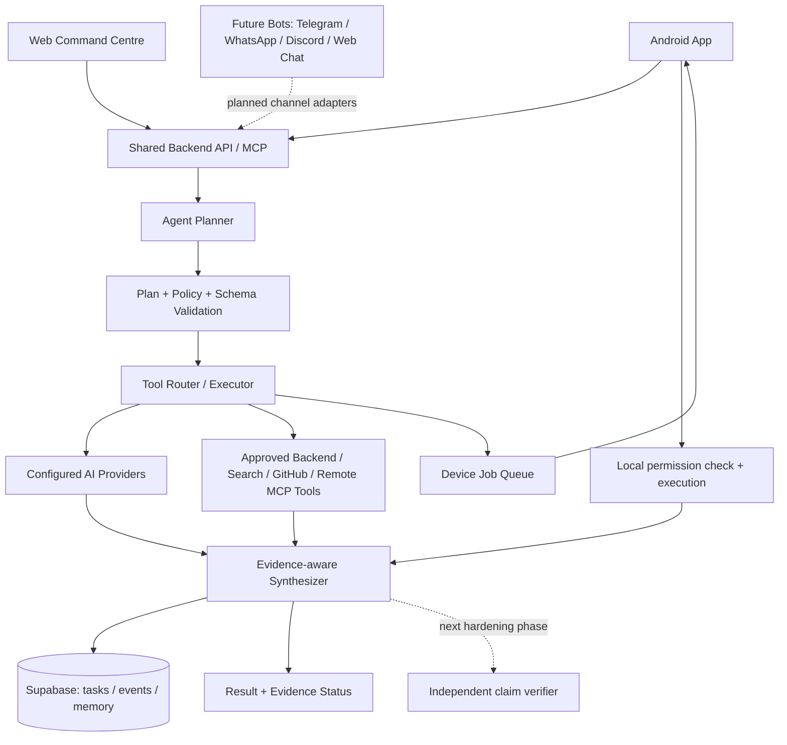

<div align="center">

# Futuristic System
### AI Orchestration Backend · MCP Server · Device Bridge

**One personal AI platform. Multiple interfaces. One secure orchestration layer.**

Futuristic System is designed to connect an Android client, a web Command Centre, AI providers, approved tools, persistent context, and future messaging bots through one owner-controlled backend.

<br/>

[](https://nextjs.org/)
[](https://www.typescriptlang.org/)
[](https://modelcontextprotocol.io/)
[](https://supabase.com/)
[](https://render.com/)

<br/>

**Project status:** Backend and Agent foundation in active development · Android end-to-end validation pending · Bot channels planned after Agent Engine hardening

</div>

---

## What is Futuristic System?

Futuristic System is being built as a personal AI platform: one system that can understand a task, choose the right AI model, use approved tools, remember useful context, and coordinate work across connected devices.

This repository contains the **website Command Centre and central backend**. It does not contain the Android application source.

The backend is the shared control plane: it authenticates owner requests, plans tasks, selects configured AI providers, validates and routes approved tools, stores task history and memory, exposes capabilities through MCP, and queues work for paired devices. The Android app is intended to be a separate client for explicitly permitted local actions; its end-to-end runtime integration is still subject to device-side implementation and validation. Future bots will be additional clients of the same Agent Engine—not separate AI brains.

### The problem it solves

AI capabilities are often fragmented:
- Different tasks need different models and providers.
- Tools and device capabilities are exposed through different interfaces.
- Context and task history are difficult to keep consistent.
- Cloud services should not silently gain access to private device data or permissions.

Futuristic System brings these concerns behind one modular backend, with an explicit boundary between **cloud coordination** and **local device execution**.

## Why Android, Website, Backend and MCP all exist

These components solve different problems and are designed to work together:

| Component | Why it exists | What it does |
| --- | --- | --- |
| **Android app** | Phones own local capabilities and permissions. | Acts as a trusted device client for supported sensors, files or other capabilities that the app explicitly implements. It checks Android permissions and consent locally before execution. |
| **Website Command Centre** | The owner needs one place to configure and supervise the system. | Manages AI provider keys and routing, Agent definitions, tool allowlists, connections, memory, devices, task history and tests. The website is the control interface—not the AI model itself. |
| **MCP Backend** | Every interface needs one consistent, secured orchestration layer. | Runs APIs, Agent planning, validation, tool routing, provider selection, persistence and device-job coordination. |
| **MCP protocol** | External MCP-compatible clients need a standard way to discover and call approved capabilities. | Exposes registered tools, resources and prompts. MCP is a protocol; it does not provide intelligence or grant extra permissions. |
| **Future bot channels** | The same Agent Engine should be reachable from messaging platforms. | Telegram, WhatsApp Business, Discord and web chat are planned as channel adapters that will call the same backend policies and Agents. They are not implemented yet. |

> **One AI system. Multiple interfaces. One backend. Explicit permissions. Evidence-backed results.**

| Layer | Responsibility |
| --- | --- |
| AI orchestration | Plan tasks and coordinate multi-step execution |
| Provider routing | Select a provider/model for each workflow, with fallback |
| MCP interface | Expose tools, resources, and prompts through a standard protocol |
| Tool layer | Validate arguments and execute allow-listed backend capabilities |
| Memory | Store and retrieve persistent owner context |
| Device bridge | Register devices, discover capabilities, queue jobs, and receive results |
| Command Centre | Configure providers, workflow policies, tools, memory, and devices |

## System architecture



The system separates **intelligence**, **orchestration**, **tools**, **storage**, and **local execution**. A server-side task request is not permission to access a phone. The backend can queue only registered capabilities for a paired device; the client must enforce its own permission and consent checks.

### Typical task lifecycle

1. **Receive** — accept a task through the backend API or MCP.
2. **Plan** — break the request into structured steps.
3. **Route** — select a workflow-specific provider/model or an approved tool.
4. **Validate** — check tool names and arguments against known schemas.
5. **Execute** — run backend tools on the server, or queue device work for a connected device.
6. **Synthesize** — produce an evidence-labelled result from returned tool outputs. An independent claim verifier and cross-source contradiction checks remain planned hardening work.
7. **Persist** — retain task events and permitted memory for continuity.

The device bridge is a coordination contract, not remote unrestricted control. The backend does not directly access a phone's files, camera, microphone, sensors, installed apps, contacts, messages, or Android permissions. Only capabilities actually implemented and advertised by a paired client can be queued; local authorization and execution remain on that device.

## Capabilities

### Where the AI intelligence comes from

The model is the reasoning/generation engine; this backend supplies orchestration, tools, policies and context. **MCP itself is not an AI model.**

- **Currently wired for text generation:** OpenAI and OpenRouter adapters, with workflow-specific provider/model policies and fallback routing.
- **Mock provider:** deterministic test/development behavior only. It is not real AI inference and must never be presented as such.
- **Web research:** the `web.search` tool uses a separately connected Tavily API credential. Tavily search is a retrieval service, not the language model.
- **Credential handling:** provider secrets are encrypted at rest with AES-256-GCM and loaded server-side. They are not sent to the Android app or exposed in dashboard responses.
- **Provider catalogue versus working adapter:** Gemini, Anthropic, Ollama, vLLM, NVIDIA NIM, Hugging Face TGI and ComfyUI appear as provider-adapter targets/catalog entries. They are not all connected to the current text-generation runtime; each needs its own implemented adapter, configuration and tests before it can be called supported for execution.
- **Local GGUF:** a local model runtime is a roadmap item, not a currently available inference engine in this repository.

**Zero-budget reality:** mock tests and deterministic local/backend tools can run without a paid model. Genuine cloud inference requires a configured provider key and is subject to that provider's free quota, rate limits and billing. No unlimited free AI access is promised.

- Agent Lab includes a dedicated Test Center with separate buttons for Word count, Keyword extraction, Text statistics, Tool permission boundary, Task idempotency and Cancellation safety, plus a Run all tests action. Tests report PASS/FAIL/SKIPPED from actual backend task/API results; task-level checks require a Mock-provider Agent and at least one assigned deterministic local text tool.

## Agent execution and Agent Manager
- Structured task planning with strict validation of plans and tool arguments.
- Persistent, owner-managed specialist Agent definitions with role and instruction guidance.
- Per-Agent provider/model preferences, registered-tool allowlists, and bounded step/tool-call limits.
- Agent configuration snapshots retained with task history, even if a definition is later edited or deleted.
- Owner-authenticated Agent Manager CRUD APIs and dashboard at `/dashboard/agents`.
- Allow-listed backend tools, task status, event history, and result synthesis.
- Failure diagnostics in task history: failed execution stage (`planning`, `policy_validation`, `tool_execution`, `synthesis`, or `finalization`) plus a sanitized, user-safe error message. Unexpected internal errors remain generic; credentials and arbitrary exception details are not exposed.
- Agent task submission accepts an optional `Idempotency-Key` header; repeated keys return the original task only when the normalized task and selected Agent match. Reusing a key for different work is rejected.
- Owner-authenticated task cancellation is available at `POST /api/v1/agent/tasks/:taskId/cancel`. Queued/device-waiting work can be cancelled immediately; active work observes cancellation at safe checkpoints between tools and before final completion. An already-running external call cannot be forcibly interrupted.
- These lifecycle changes are in PR #30 and require the new Supabase migrations before deployment. They do not yet provide a durable background worker, automatic task retries, or crash-resume of the full Agent plan.
- Evidence-aware synthesis guard and nested tool-schema hardening are under [PR #30](https://github.com/kandarpprajapati567-alt/MCP-backend/pull/30). The PR is open and not merged; do not treat these changes as deployed production behavior.
- Read-only GitHub repository inspection: list branches and commits, browse file paths, and read bounded text files from this repository.

### Model Context Protocol
- Streamable HTTP JSON-RPC endpoint at `/api/mcp`.
- Tools, resources, and prompts discovery and invocation.
- Stateless MCP transport.
- Owner-authenticated access to the registered tool surface; MCP does not bypass the backend's allowlists, authentication or device permission boundary.

### Persistent memory
- Owner-scoped memory storage and search.
- Supabase Postgres persistence.
- Memory management endpoints.

### Device coordination
- Device registration and capability discovery.
- Queued device-tool jobs.
- Job claiming and result callbacks.
- Task finalization after device results arrive.

### Personal Command Centre
- Manage provider credentials and workflow routing.
- Inspect tools, memory, and registered devices.

## Security and trust boundaries

Security is part of the architecture, not an optional add-on.

- **Server secrets stay on the server.** Never embed the owner master token, provider API keys, or Supabase secret key in an Android APK.
- **Device actions stay local.** The connected app must enforce Android permissions and user consent before executing a device-side action.
- **Validate before execution.** Tool identifiers and arguments must match registered capabilities and schemas.
- **Use scoped device credentials.** Device pairing codes are single-use and short-lived; device tokens are stored as hashes and can be revoked independently.
- **Keep data access explicit.** A backend job request is not permission to read private files, camera frames, sensors, or other local data.

Current private API access uses the server-side owner token. This is a personal owner-mode foundation, not a public multi-user authentication system.

## API overview

Owner APIs require the owner master token. Device pairing-claim and device-work endpoints use a device-scoped bearer token; the Android APK never receives the owner master token.

| Method | Endpoint | Purpose |
| --- | --- | --- |
| POST | `/api/mcp` | MCP Streamable HTTP |
| GET | `/api/v1/health` | Public health check |
| GET | `/api/v1/tools` | Tool catalog |
| GET, POST | `/api/v1/agent/tasks` | List and submit tasks, optionally with `agentId` |
| GET, POST | `/api/v1/agents` | List and create Agent definitions |
| PATCH, DELETE | `/api/v1/agents/:agentId` | Update or delete an Agent definition |
| GET | `/api/v1/agent/tasks/:taskId` | Task status, events, and jobs |
| POST | `/api/v1/ai/generate` | Routed text generation |
| GET, PUT, DELETE | `/api/v1/ai/providers/keys` | Provider credentials |
| GET | `/api/v1/ai/providers/health` | Provider health |
| GET | `/api/v1/ai/usage` | Usage and limits |
| GET, PUT, DELETE | `/api/v1/ai/policies` | Workflow routing policies |
| GET, POST, DELETE | `/api/v1/memory` | Owner memory |
| GET, POST, PUT, DELETE | `/api/v1/devices` | Owner management and paired-device manifest refresh |
| POST | `/api/v1/devices/pairing` | Create a 5-minute, single-use pairing code (owner token) |
| POST | `/api/v1/devices/pairing/claim` | Exchange pairing code for a device-scoped token |
| PUT | `/api/v1/devices` | Refresh this device's manifest (device token) |
| POST | `/api/v1/devices/jobs` | Queue device job |
| POST | `/api/v1/devices/jobs/claim` | Claim queued job (device token) |
| POST | `/api/v1/devices/jobs/result` | Submit device result (device token) |
| GET, PATCH | `/api/v1/profile` | Owner profile |

### MCP connection details

- **Production endpoint:** `https://mcp-backend-2oyj.onrender.com/api/mcp`
- **Method:** `POST`
- **Content-Type:** `application/json`
- **Accept:** `application/json, text/event-stream`
- **Authorization:** `Bearer <FS_OWNER_TOKEN>`

Supported protocol methods: `initialize`, `ping`, `tools/list`, `tools/call`, `resources/list`, `resources/read`, `prompts/list`, and `prompts/get`.

Current registered capabilities include bounded text processing, owner memory, device registry/dispatch, Agent task submission/status, provider discovery, read-only GitHub repository inspection, and Tavily-backed web search when configured. Owner-managed remote MCP connections support encrypted bearer credentials, connection testing, sanitized discovery and per-Agent allowlisting. Only the remote tools that pass the current read-only contract are exposed; remote server annotations are not cryptographic proof of safety. The Agent Lab includes separate **Test** buttons for each deterministic text check, permission boundary, task idempotency and terminal-task cancellation safety, plus **Run all tests**. Each result is based on real owner-authenticated backend responses; skipped tests are not counted as passes. See `docs/REMOTE-MCP.md` and `docs/CONNECTIONS-HUB.md` for exact restrictions.

## Deployment

| Environment | Role | Details |
| --- | --- | --- |
| Render | Production backend | [mcp-backend-2oyj.onrender.com](https://mcp-backend-2oyj.onrender.com) |
| GitHub `main` | Production source branch | Render auto-deploys from this branch |
| GitHub `main` | Agent Manager and read-only GitHub tools | Merged and included in the production source branch |
| Vercel | Preview/build validation | Two linked projects; SSO protection is enabled |

The Render service is the production API host. Vercel preview deployments are not the Android app's production base URL. Failure diagnostics are persisted as `task.failed` events and surfaced by the owner-scoped task-list API; no database migration is required.

## Run locally

### Requirements
- Node.js 22 or later
- npm
- Supabase project and server-side credentials

### Setup

The Agent Manager database migrations are tracked in `supabase/migrations/20261111043908_create_agent_definitions.sql` and `supabase/migrations/20261111043934_index_agent_tasks_agent_definition_id.sql`. They have been applied to the configured MCP Backend Supabase project. For another environment, review and apply these migrations before using Agent CRUD or submitting tasks with an Agent. The application does not run database migrations automatically.

```bash
git clone https://github.com/kandarpprajapati567-alt/MCP-backend.git
cd MCP-backend
npm install
cp .env.example .env.local
```

Add the required environment variables to `.env.local`:

| Variable | Purpose |
| --- | --- |
| `NEXT_PUBLIC_SUPABASE_URL` | Supabase project URL |
| `NEXT_PUBLIC_SUPABASE_PUBLISHABLE_KEY` | Supabase publishable key |
| `SUPABASE_SECRET_KEY` | Server-only Supabase secret |
| `AI_PROVIDER_ENCRYPTION_KEY` | Stable 32-byte base64 encryption key |
| `FS_OWNER_TOKEN` | Long random owner master token |
| `GITHUB_READ_TOKEN` | Optional fine-grained GitHub token with read-only Contents and Metadata access, scoped only to this repository |

Never commit real credentials. Never expose server secrets through a `NEXT_PUBLIC_` variable. GitHub tools are limited to the fixed repository `kandarpprajapati567-alt/MCP-backend`; they require `GITHUB_READ_TOKEN`, never accept arbitrary repository names, block secret-like file paths, and cap individual file reads at 200 KB. The GitHub token is used only server-side and is never returned to an Agent.

### Start development server

```bash
npm run dev
```

### Validate changes

```bash
npm run typecheck
npm run test
npm run build
```

GitHub Actions runs typecheck, tests, and a production build.

## How far can the backend reach?

The backend's reach is limited to configured integrations and capabilities explicitly registered with it. It is not a universal remote-control service.

| Reach | Current boundary |
| --- | --- |
| Supabase | Owner-scoped application data, Agent/task/event records, provider metadata and memory through server-side credentials. Supabase stores data; it does not generate AI answers. |
| AI providers | OpenAI or OpenRouter only when the owner has configured a valid provider credential and model policy. Provider quotas and network availability apply. |
| Public web research | Tavily-backed `web.search` only when a Tavily key is connected; results are returned as bounded source references/excerpts. |
| GitHub | Read-only inspection of the fixed Futuristic System MCP Backend repository when the server-side read token is configured. It is not arbitrary GitHub write access. |
| Remote MCP | Only owner-registered HTTPS endpoints that pass connection restrictions; current discovery intentionally exposes read-only annotated tools after schema sanitization. |
| Paired device | Only a paired, recently online device's advertised capabilities. The backend has a device-bridge contract for Android/Windows-style clients; actual client support must be demonstrated. Jobs are queued by the backend and must be permission-checked and executed by the client. |
| External clients | MCP clients with valid owner authorization can discover/call only the backend's registered MCP tools. The owner token must remain server-side. |

The backend **cannot automatically** read arbitrary phone files, camera/microphone streams, contacts, SMS, notifications, installed-app data, or control Android settings. It cannot bypass Android permissions, root the phone, execute arbitrary APKs, or access unregistered devices. A future feature must be implemented in the client, exposed as a bounded tool, permission-gated locally and tested end to end before it is described as available.

This is currently a personal owner-mode foundation, not a public multi-user SaaS or unrestricted open bot platform.

## Android integration status

The backend-side pairing, device-scoped authentication, capability manifest and job queue/result contracts exist. That proves the **server contract** exists; it does not by itself prove the Android client can complete every task. Production readiness requires a real app-side round trip: pair, securely store the device token, check in, claim a job, validate locally, request/verify Android permission, execute, return a bounded result, reconnect and revoke. See [Android Device Bridge](docs/android-device-bridge.md).

## Roadmap and implementation order

The order is deliberate: **finish a trustworthy Agent Engine first; then connect more interfaces to that same engine.** Bots must not be built on top of an unreliable execution core.

### Current foundation
- [x] Next.js web Command Centre and owner-authenticated backend APIs
- [x] MCP Streamable HTTP endpoint and registered tool catalog
- [x] OpenAI / OpenRouter text-generation adapters and mock testing provider
- [x] Encrypted provider credential storage and workflow routing
- [x] Agent planning/validation foundation and Agent Manager definitions
- [x] Expanded bounded planning capacity: up to 16 planning steps and 8 registered tool calls per Agent plan (configurable, schema-validated, not unlimited execution)
- [x] Supabase-backed owner memory, task records and event history
- [x] Device pairing, scoped device credentials and backend job-bridge contracts
- [x] GitHub read-only tools, Tavily web search connector and restricted remote MCP connections
- [x] Agent Lab test controls

### Phase 1 — Complete and harden the Agent Engine (current priority)
- [ ] Independent claim verifier and contradiction/confidence reporting
- [ ] Evidence provenance, source freshness and cross-source checks beyond the current synthesis guard
- [ ] Durable worker lifecycle, cancellation, idempotency and recovery for long-running tasks
- [ ] Central risk/permission policy enforced immediately before side effects
- [ ] Certification registry, versioned suites and evidence-backed trust-level display

### Phase 2 — Android device integration
- [ ] End-to-end Android pairing and authenticated check-in validation
- [ ] Secure device-token storage, job polling/reconnect and local permission UI
- [ ] Device tool execution/result callbacks with failure and revocation tests

### Phase 3 — Universal Bot / Channel Gateway (planned next interface family)
- [ ] Shared channel adapter contract, identity mapping and per-channel session isolation
- [ ] Telegram bot adapter and webhook/secret verification
- [ ] Discord bot adapter and interaction signature verification
- [ ] WhatsApp Business Platform / Cloud API adapter, template and opt-in compliance
- [ ] Website chat interface using the same Agent task API
- [ ] Android assistant/chat interface using the same backend Agent Engine
- [ ] Per-channel tool allowlists, user consent, rate limits, abuse controls and audit history

**Bot status:** Telegram, WhatsApp, Discord and website chat bots are roadmap items. No live bot integration is claimed in this repository today. The shared gateway, normalized channel contract, identity linking, webhook verification, session isolation and rollout gates are documented in [Bot Channel Architecture](docs/BOT-CHANNEL-ARCHITECTURE.md). Messaging providers may require their own accounts, approvals, credentials and usage fees; a ₹0 budget does not guarantee free production messaging.

### Phase 4 — Research and local intelligence
- [ ] YouTube metadata/transcript research where legally and technically accessible
- [ ] Local GGUF model runtime and resource-aware routing
- [ ] Source-grounded study/research workflows and handwritten-notes generation pipeline
- [ ] Public multi-user authentication and release hardening

Roadmap checkboxes represent repository evidence, not aspirations. A feature is marked complete only after its implementation and relevant tests are verified. See [Agent Trust & Capability Levels](docs/AGENT_TRUST_LEVELS.md) for the evidence-based assurance ladder and [Bot Channel Architecture](docs/BOT-CHANNEL-ARCHITECTURE.md) for the planned channel gateway.

## Repository structure

```
app/          Next.js application and API routes
docs/         Architecture and integration documentation
public/       Static assets
```

The codebase is evolving; consult the source tree for the current module-level structure.

## Contributing and project direction

This repository is the backend foundation for the wider Futuristic System project. Changes should preserve modular provider routing, validated tool execution, explicit security boundaries, and compatibility with the Android device bridge.

Issues and focused pull requests are welcome. Please do not submit real API keys, tokens, personal data, or production secrets.

---

<div align="center">

**Futuristic System**  
*Building a coordinated, user-controlled personal AI platform.*

</div>
