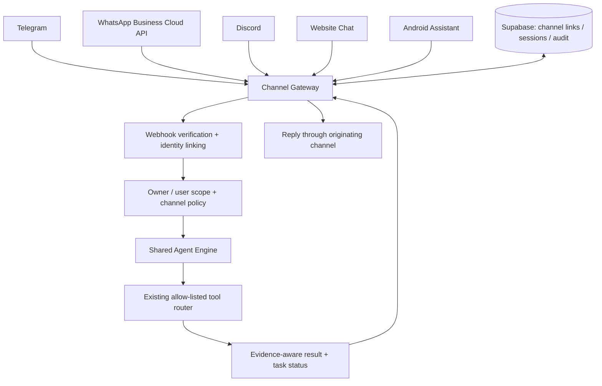

# Universal Bot / Channel Gateway — Architecture Plan

**Status: Planned. No production Telegram, WhatsApp, Discord or website-chat bot is implemented by this document.**

## 1. Product decision

Futuristic System will use **one shared Agent Engine and multiple channel adapters**. A Telegram bot, Discord bot, WhatsApp Business integration, website chat and Android assistant must not grow separate planners, tool permissions, memory stores or execution engines.

Each channel translates its provider's inbound event into a normalized message, authenticates the channel identity, applies channel policy, and submits an authorized task to the existing backend Agent API. Replies return through the originating channel adapter.

## 2. Target architecture

## 3. Channel adapter contract

Every adapter should implement the same narrow responsibilities:

1. Verify the provider's webhook or interaction signature/secret before processing the event.
2. Normalize provider payloads into a versioned internal envelope.
3. Deduplicate inbound events using the provider's stable event/message ID.
4. Resolve the external account to an explicitly linked Futuristic System owner/user identity.
5. Enforce per-channel allowlists, rate limits, session boundaries and consent rules.
6. Submit the request through the same Agent task service; never call arbitrary tools directly.
7. Deliver the result to the same conversation and record delivery status without logging secrets.

The normalized envelope should carry channel ID, provider event ID, external sender ID, conversation ID, message text, bounded attachment references, received timestamp and verified-authentication metadata. Provider-supplied identity fields are untrusted until signature verification and account linking succeed.

## 4. Identity, privacy and permissions

- No public, anonymous bot access by default. A user must link or be explicitly authorized for the owner-controlled system.
- Never send the owner master token or provider credentials to a bot client or end user.
- Store channel tokens encrypted server-side and support rotation/revocation.
- Keep channel sessions isolated by owner, channel, external user and conversation.
- Apply the same Agent tool allowlist and server-side execution policy used by website/API/MCP tasks.
- Require explicit confirmation for external messages, publishing, purchases, destructive actions and device-control side effects.
- Do not expose private memory, task history or device capabilities across unlinked users or conversations.
- Apply attachment size/type limits, malware/content checks where appropriate, retention limits and prompt-injection handling.
- Add rate limits, replay protection, abuse controls, audit events and a global kill switch.

A messaging platform's bot token authenticates the bot to that platform; it does not authorize the sender to access Futuristic System owner data.

## 5. Planned channel rollout

| Channel | Planned integration | Important requirements |
| --- | --- | --- |
| Telegram | Bot API adapter | Bot token, webhook secret verification, sender linking, rate limits |
| Discord | Bot / interactions adapter | Application credentials, request-signature verification, permission scopes |
| WhatsApp | WhatsApp Business Platform / Cloud API | Meta business/app setup, webhook verification, opt-in, approved templates where required, provider policy and possible messaging charges |
| Website | Authenticated chat interface | Existing owner session, CSRF/origin protections, streaming/task status and same Agent API |
| Android | In-app assistant interface | Device/user identity separation, secure device credentials, Android local permissions for device actions |

Implementation order can be adjusted by provider access and user priorities. The shared gateway and identity/policy boundary must be built before adding more channels.

## 6. Integration sequence

### Gate A — Agent Engine readiness

Complete and verify plan validation, execution-time policy enforcement, task lifecycle/recovery, evidence provenance, independent verification, audit history and deterministic test coverage. Bot work must not bypass unfinished safety gates.

### Gate B — Channel Gateway foundation

Define versioned adapter interfaces, normalized event envelopes, channel-account linking, encrypted credential storage, session isolation, webhook verification, deduplication, rate limits and outbound delivery tracking. Add tests before connecting a public channel.

### Gate C — First channel

Implement one provider end to end, including setup instructions, secret rotation, inbound/outbound tests, abuse limits, user authorization and task audit trail. Telegram is a reasonable first candidate because the integration surface is relatively small, subject to bot-token setup and current provider requirements.

### Gate D — Additional channels

Add Discord, WhatsApp Business Cloud API, website chat and Android assistant as independent adapters. Reuse the same Agent Engine and never duplicate business logic or tool execution.

### Gate E — Release assurance

Run provider-specific webhook replay/signature tests, cross-user isolation tests, permission tests, load/rate-limit tests, failure/retry tests and a production smoke test. A channel is not marked complete merely because its webhook responds.

## 7. Cost and availability

The backend project targets a zero-budget development path, but production bot access is not guaranteed to be free. Telegram and Discord bot APIs may be usable without a platform messaging fee under their current terms, while hosting and AI-provider usage can still cost money. WhatsApp Business may require business setup, templates, eligibility and paid messaging depending on the current Meta pricing and rules. Verify provider requirements at implementation time; never promise unlimited free messaging or AI inference.

## 8. Completion criteria

A channel may be marked **implemented** only when all of the following are demonstrated:

- Webhook or interaction authenticity is verified.
- External identity is explicitly linked and correctly scoped.
- Duplicate/replayed events do not execute a task twice.
- Agent tool permissions and side-effect approvals are enforced.
- Sessions and memory cannot leak between users or channels.
- Secrets are encrypted, redacted and revocable.
- Inbound, outbound, retry, timeout and provider outage paths are tested.
- Task status and evidence-aware responses are traceable.
- A deployed end-to-end smoke test passes.

Until those checks pass, show the channel as **planned**, **in development** or **not configured**—never as connected.
